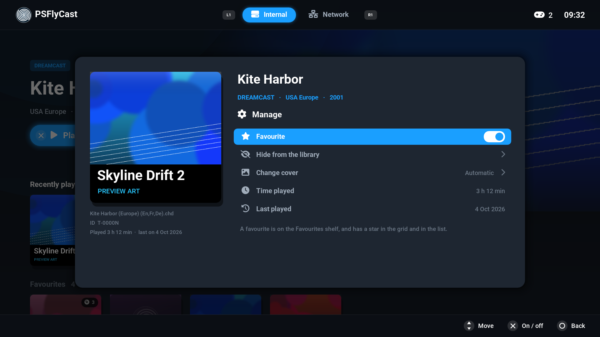
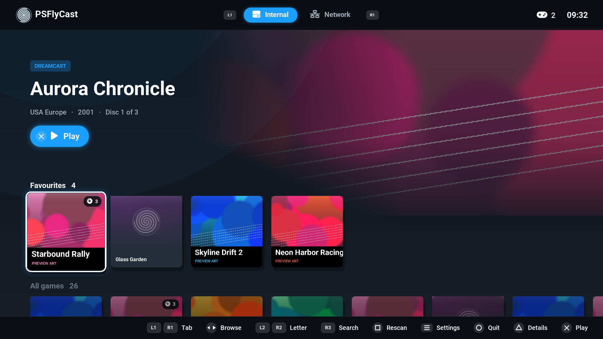
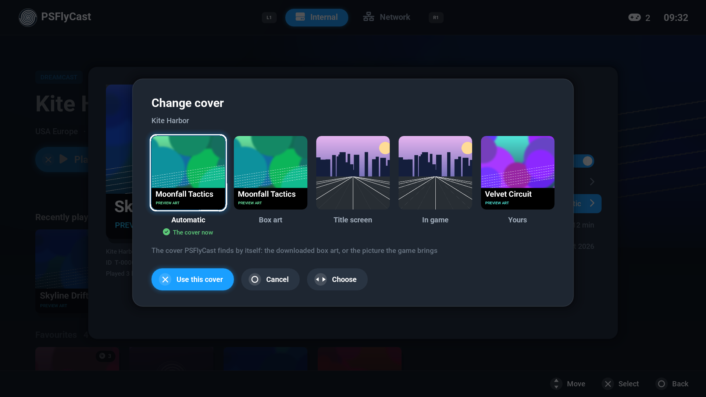
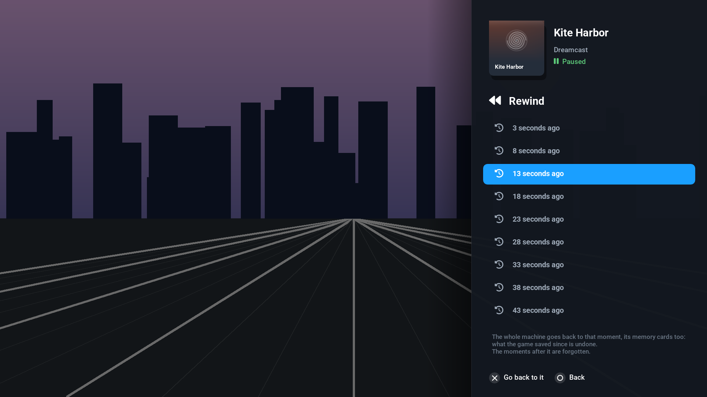
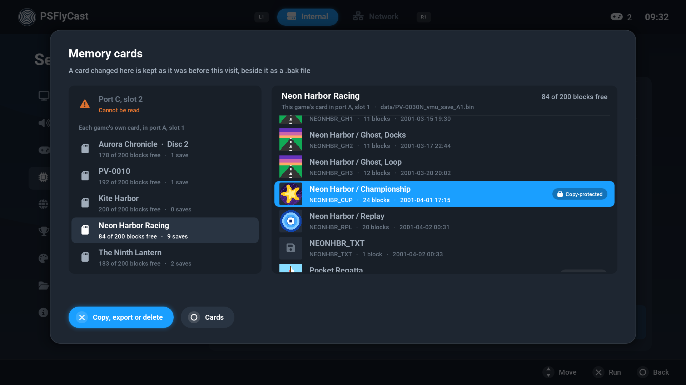
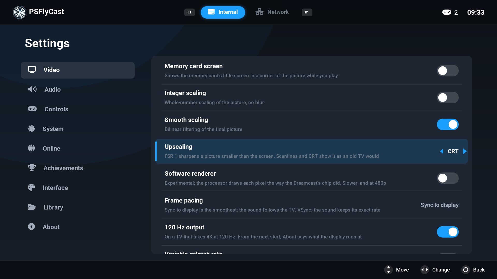
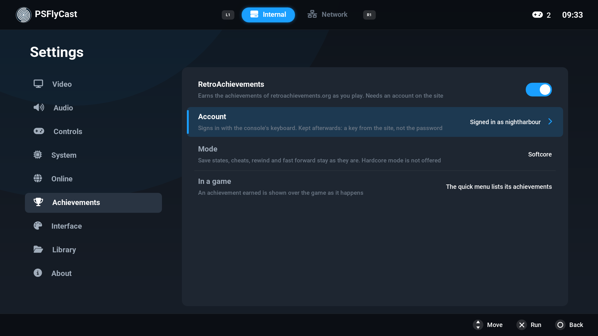

# PSFlyCast user manual

How to install PSFlyCast, add your games and use everything in it. For how it
is built and what it is made of, see [README.md](README.md).

This manual is for v1.3.4 (build 92). The README's Status says what has been
played on a console.

> **No games, BIOS files or keys come with PSFlyCast, and none ever will.**
> Use only backups you made yourself of games you own, and BIOS files dumped
> from your own console.

## Contents

1. [What you need](#1-what-you-need)
2. [Install and update](#2-install-and-update)
3. [Add your games](#3-add-your-games)
4. [The library](#4-the-library)
5. [Favourites, hidden games and covers](#5-favourites-hidden-games-and-covers)
6. [Playing a game](#6-playing-a-game)
7. [The quick menu](#7-the-quick-menu)
8. [Saving](#8-saving)
9. [Rewind](#9-rewind)
10. [Memory cards](#10-memory-cards)
11. [Games on several discs](#11-games-on-several-discs)
12. [Options for one game](#12-options-for-one-game)
13. [Cheats and patches](#13-cheats-and-patches)
14. [Changing the controls](#14-changing-the-controls)
15. [More players](#15-more-players)
16. [Settings](#16-settings)
17. [Achievements](#17-achievements)
18. [Games on a network share](#18-games-on-a-network-share)
19. [Games on a USB drive](#19-games-on-a-usb-drive)
20. [Playing online](#20-playing-online)
21. [Updating from inside PSFlyCast](#21-updating-from-inside-psflycast)
22. [The look](#22-the-look)
23. [Where your files are](#23-where-your-files-are)
24. [When something goes wrong](#24-when-something-goes-wrong)

## 1. What you need

- A jailbroken PS5 with
  [ShadowMountPlus](https://github.com/drakmor/ShadowMountPlus), or another
  launcher that starts titles from `/data/homebrew/`.
- A way to copy files to the console, such as its FTP server.
- Your own games. A DualSense controller; up to four work, one for each
  logged-in user.

## 2. Install and update

1. Unpack the release ZIP. It holds one folder, `PPSA99247`.
2. Copy that folder to `/data/homebrew/` on the console, so that it is
   `/data/homebrew/PPSA99247/`.
3. Wait for the launcher to report the title ready, then start **PSFlyCast**
   from the home screen.

**To update**, copy the new `PPSA99247` folder **over** the old one and let
it replace the files. Do not delete the old folder first: your games, saves,
settings and covers are inside it. PSFlyCast can also fetch and install a
new version itself: see
[Updating from inside PSFlyCast](#21-updating-from-inside-psflycast).

## 3. Add your games

Copy your games into `/data/homebrew/PPSA99247/games/`, then press **Square**
in the library to scan. Folders inside `games/` are scanned too.

| System | File types |
|---|---|
| Dreamcast | `.chd`, `.gdi` (with its track files), `.cdi`, `.cue` (with its `.bin` files) |
| NAOMI, NAOMI 2, Atomiswave | `.zip` or `.7z` arcade sets |
| Dreamcast, packed | a `.zip`, `.7z` or `.rar` with a `.gdi`, `.cue`, `.cdi` or `.chd` inside (see below) |

`.chd` is the best choice for Dreamcast games: one file, and the smallest.

**Games in archives.** A `.zip`, `.7z` or `.rar` that holds a disc image is
listed in the library like the image itself. When you start it, the image is
unpacked into `cache/archive/` and played from there; the last one stays, so
starting it again is quick, and the next archive replaces it. There has to be
room for the unpacked game (PSFlyCast says how much is needed). A `.7z` is
unpacked in memory first, so a very large solid `.7z` may not fit: a `.zip`
or `.rar` has no such limit. Settings > Library > Free up space clears the
unpacked images.

**BIOS files** go in `bios/`:

- Dreamcast games start without one, using the built-in BIOS. A real
  `dc_boot.bin` and `dc_flash.bin` start more games correctly. Settings >
  About > Dreamcast BIOS says which one is in use.
- Arcade games need their BIOS sets (`naomi.zip`, `awbios.zip` and so on).

Games can also be played from a [network share](#18-games-on-a-network-share)
or a [USB drive](#19-games-on-a-usb-drive).

## 4. The library

The library is what you see when PSFlyCast starts.

| Button | Does |
|---|---|
| D-pad or left stick | Move between games |
| Cross | Play the game |
| Triangle | Game details |
| Square | Scan the open tab for games again |
| L1 / R1 | Previous / next tab: Internal, USB, Network |
| L2 / R2 | Jump by letter: R2 to the first game of the next letter, L2 back |
| R3 (press the right stick) | Search |
| Circle | Leave PSFlyCast (it asks first). With a search: show every game again |
| OPTIONS | Open or close the Settings |

- **Tabs.** Internal is the `games/` folder. The USB tab is there only when
  USB drives are turned on, and the Disc Drive tab only when USB disc drive is. Each tab remembers where you were, and PSFlyCast
  opens on the tab you used last.
- **Views.** Shelves (with a Recently played row and, once you have made
  some, a Favourites row), a compact grid, or a list.
  Change it in Settings > Library > Library view.
- **Search.** R3 opens the console's keyboard. Type a title or part of it
  and the tab shows only the games whose title has every word you typed;
  L1 and R1 look in the other tabs. Circle shows every game again.
- **Leaving.** Circle in the library asks **Quit PSFlyCast?**: Cross quits,
  Circle stays. (Settings > About > Quit PSFlyCast is still there.)
- **Covers and descriptions** are downloaded by the game's file name. Names
  in the usual dump style, such as `Game (USA).chd`, are found most reliably.
  To use a cover of your own, save it as `<game file name>.png` (or `.jpg`) in
  `covers/`. Settings > Library > Download covers and descriptions turns
  downloading off. A game's details can also give it another picture: see
  [Favourites, hidden games and covers](#5-favourites-hidden-games-and-covers).
- **Game details** (Triangle) shows the description and five actions: **Play**,
  **Load state** (start from a saved state), **Options** (settings for this
  game only), **Cheats** and **Manage** (favourite, hide, cover, time
  played). Under the cover it says how long you have played the game and
  when you last did. Circle goes back.

While a game loads, Circle cancels.

## 5. Favourites, hidden games and covers

Press **Triangle** on a game, go right to **Manage** and press Cross. Circle
goes back.



| Row | Does |
|---|---|
| Favourite | Cross makes the game a favourite, or no longer one |
| Hide from the library | Cross hides the game. On a hidden game the row is **Show in the library again** |
| Change cover | Opens the choice of covers |
| Time played | How long the game has run |
| Last played | The day you last played it |

**Favourites.** A favourite is on the **Favourites** shelf, which comes after
Recently played, and has a star in the grid and in the list. Each tab has
its own shelf.



**Hidden games.** A hidden game leaves every list of the library, and the
search does not find it. Nothing is deleted. To bring one back, turn on
Settings > Library > **Show hidden games**: the hidden games are listed
again, dimmed and marked with a struck-through eye. Open the game's details,
then Manage > **Show in the library again**. Settings > Library > Hidden
games says how many there are.

**Time played** counts while the game itself runs, not while the quick menu
or the Settings are open. A game you last played with an earlier version
says "Before play time was kept": its time starts counting now.

A game on several discs counts as one game: all its discs are favourites or
hidden together, and their times are added up.

**Change cover.** Up to five pictures are offered, side by side:



| Picture | Is |
|---|---|
| Automatic | The cover PSFlyCast finds by itself: the downloaded box art, or the picture the game brings |
| Box art, Title screen, In game | Three pictures of the game from the collection the covers come from, downloaded when you open this |
| Yours | Your own picture from `covers/`, if you put one there |

Left and right choose, **Cross** uses the picture, Circle leaves the cover as
it is. The one in use says "The cover now". A picture that could not be
downloaded says so, and **Square** asks for it again.

- The three downloaded pictures are found by the game's file name, as covers
  are, and need downloading to be on (Settings > Library).
- They exist for Dreamcast disc games only: an arcade game has Automatic and
  your own picture.
- All the discs of a game take the cover you choose.
- Your own picture is never deleted. While another cover is in use it is
  put aside, and **Yours** brings it back.

## 6. Playing a game

| DualSense | Dreamcast | Arcade |
|---|---|---|
| Cross / Circle / Square / Triangle | A / B / X / Y | Buttons 1 / 3 / 2 / 4 |
| L2 / R2 | Left / right trigger | Left / right trigger |
| L1 / R1 | Z / C | Buttons 6 / 5 |
| OPTIONS | Start | Start |
| Left stick | Analog stick | Stick, or joystick (see below) |
| D-pad | D-pad | Joystick |
| L3 / R3 | | Insert coin / Service |
| **Touch pad click** | **Quick menu** | **Quick menu** |

Most arcade games have a digital joystick, which is the D-pad. In those the
**left stick moves the joystick too**; in a game with a wheel, a flight stick
or a light gun it stays the analog stick. Settings > Controls >
**Left stick as D-pad** turns this on for every game or off, and a game can
have its own choice (the quick menu's **Controls**):
on suits a Dreamcast game that only reads the D-pad.

**The controller as a mouse and a keyboard** (build 65 on, not tried on a
console yet). Dreamcast games that aim with a mouse and move with a keyboard
can be played with the DualSense. In Settings > Controls (or a game's own
options), **Right stick as mouse** makes the right stick the Dreamcast's mouse:
R2 is the left button, L2 the right one, R3 the middle one; **Mouse speed**
tunes it. **Mouse movement** chooses what moves the mouse: the right stick, turning the
controller like a pointer (**Motion**), or **Both**; **Motion aiming speed** and **Motion aiming
smoothing** below tune the turning, and **Motion aiming direction** swaps its directions. The right stick's own settings shape the mouse, the turning and a second stick alike: **Right stick dead zone** (round the centre, so a stick
that rests off it is still), **Right stick response** (Linear; Precise, fine near the centre for aiming; Aggressive; S-curve), **Right stick smoothing**, and
**Right stick left and right** and **up and down**, each Normal, Inverted or Off. **Right stick as the triggers** makes the right stick, left and right, the Dreamcast's L and R triggers, pressed as far as the stick is pushed, for a camera that a game turns with the triggers; L2 and R2 still work, and it does nothing while the right stick is the mouse. **Right stick turns like the left stick**
adds the right stick, left and right, to the left stick's, so the game turns with it as it does with the left stick and its own sensitivity; use it instead of the mouse in a game that takes a mouse badly. **Controller profile** chooses what the controller is in the
Dreamcast's ports beside its controller. *Controller* is the controller alone. *Controller and mouse*
adds the mouse on the right stick, and the controller keeps every button. *Mouse and keyboard, WASD* and
*arrows* are for a game played with those: the right stick is the mouse, R2, L2 and R3 its buttons, L1
and R1 the wheel, the left stick W A S D (or the arrows), Cross Space, Circle C (Control), Square E
(Alt), Triangle R, L3 Shift, OPTIONS Escape, the D-pad 1 to 4. *Custom 1* to *4* are your own.
**Controller profiles** (Settings > Controls, and the quick menu's Controls) shows each profile: L1 and
R1 go from one to the next, Cross changes an entry of your own (the right stick as the mouse or the
controller's; each input the controller's, nothing, a mouse button, the wheel, or any key; L1 and R1
page the keys), Square copies a built-in profile into one of your own, Triangle makes the shown profile
the one in use. An input a profile gives away is not the Dreamcast controller's as well, so nothing is
pressed twice, and what stays "Controller" is the controller's as before. The mouse and keyboard take
a free port each when a game starts, so restart the game after changing the profile. The profile in use
is kept like the other settings: for the game, when it has settings of its own. **Controller slot 1**
and **2** can hold the Dreamcast's microphone, which hears the DualSense's, for the games that
listen; not tried on a console.

Any of these can be changed: see [Changing the controls](#14-changing-the-controls).

**Starting a game from a forwarder.** A PS5 forwarder (an icon on the home
screen for one game), or anything else that starts the title, can name the
game with launch arguments:

```
--rom "games/<folder>/<file>.chd" --exit-after-game
```

`--rom` takes a full path (`/data/homebrew/PPSA99247/games/...`,
`/mnt/usb0/...`), a path from the title's folder, or the game's name as the
library shows it. The game must be in the library: the title waits for the
library's first scan of a USB drive or share (a minute at most). With
`--exit-after-game` the title closes when that game is closed, back to the
home screen. A game that is not found says so. The boot log's `forwarder:`
lines say what was asked and what was found.

## 7. The quick menu

Click the **touch pad** during a game. The game pauses and the menu opens;
Circle or the touch pad again resumes.

| Item | Does |
|---|---|
| Resume | Back to the game |
| Save state | Saves the game exactly as it is now, in the chosen slot |
| Load state | Goes back to the state in the chosen slot |
| State slot | Chooses one of 10 slots; each shows a picture of what it holds |
| Rewind | Goes back to a moment of the last minutes (see [Rewind](#9-rewind)). Only there when Settings > System > Rewind is on |
| Fast forward | Lets the game run faster than its own pace, without sound |
| Open disc lid / Insert disc | Changes the disc (see [Games on several discs](#11-games-on-several-discs)). Dreamcast games only |
| Cheats | Switches cheats on and off |
| Achievements | Lists the game's achievements (see [Achievements](#17-achievements)). Only there when they are turned on |
| Game options | Settings for this game only |
| Controls | The controller for this game: its profile, the right stick, turbo, the slots, the light gun, and which button does what, beside a picture of the Dreamcast controller |
| Restart game | Starts the game again from its beginning |
| Quit game | Back to the library |

**Restart game** asks twice: press Cross again within four seconds. Anything
not saved is lost.

**Fast forward.** Cross turns it on and goes straight back to the game; open
the menu and press Cross on it again to turn it off. The row says On or Off.
While it is on the game has no sound. How much faster the game runs depends
on the TV's mode: PSFlyCast shows every frame for one refresh of the screen,
so with 120 Hz output a game that runs at 60 frames a second can go at most
about twice as fast, and with 60 Hz output it goes no faster. It is off again
when the game is quit, and cannot be used in netplay or while a game is
online ("Not while online").

Fast forward can be put on a button of the controller: see
[Changing the controls](#14-changing-the-controls).

**Screenshots** are the console's own: its Create button takes them, of a
game here as of anything else.

## 8. Saving

There are two kinds of save, and they are separate.

- **The memory card.** Games save to it as they do on a Dreamcast. It is
  kept in `data/`, one for each game: the discs of a game share it where
  they carry the same ID, as most do.
- **Save states.** A snapshot of the whole console, made from the quick menu.
  There are 10 slots for each game. Load one from the quick menu, or start
  the game straight from one with Triangle > Load state in the library.

Settings > System has **Auto save state** (save when you quit a game) and
**Auto load state** (resume from that state when the game starts).

A save state made by one version of PSFlyCast may not load in a later one;
memory card saves do. Keep a memory card save of anything you care about.

[Rewind](#9-rewind) is a third way back, for the last few minutes only. The
saves on a memory card can be copied, deleted and taken to and from files:
see [Memory cards](#10-memory-cards).

## 9. Rewind

Experimental, and off until you turn it on: Settings > System > **Rewind**.

With it on, PSFlyCast keeps a snapshot of the whole machine every 5 seconds
while a game runs, and holds on to the last 3 minutes of them. The quick
menu then has **Rewind**:



1. Click the touch pad and choose **Rewind**.
2. Pick a moment from the list: the newest is at the top, each named by how
   long ago it was ("13 seconds ago", "2 min 5 s ago"). L2 and R2 move
   eight at a time.
3. Press **Cross**. The game goes on from that moment.

What to know:

- **The memory card goes back too.** Anything the game saved after the
  moment you choose is undone, as if it had not happened.
- The moments after the one you choose are forgotten: there is no going
  forward again.
- The time is time played. Minutes spent in the quick menu do not count.
- The snapshots are held in memory only (up to 384 MiB; the oldest go
  first). They are gone when you quit the game, load a save state, change
  the disc or start another game. Right after one of those the row says
  "Nothing yet" until the first new snapshot, a few seconds later.
- There is no rewind in netplay, while a game is online, or in arcade games
  on linked boards.
- If going back fails, the menu says so. Should it say the game may no
  longer run right, load a save state or restart the game.

Rewind is not a save: for anything you want to keep, save a state or let
the game save to its memory card.

## 10. Memory cards

Settings > System > **Memory cards** opens the memory card manager. It opens
only while no game is loaded: with one loaded it says "Quit the game first",
because the game has its cards in use.



On the left are the cards, on the right the saves of the card you are on.

- **Shared cards** are named by their place: "Port A, slot 1" is the first
  controller's first slot.
- **Each game's own card.** A Dreamcast game normally keeps its saves on a
  card of its own in port A, slot 1, not on the shared one. These are
  listed by the game's title, or by its ID when the game is not in the
  library.

Settings > Video > **Memory card screen** shows the cards' little screens over
the game; **Memory card screen size** makes them 50% to 300% of their size.
With Settings > Audio > **VMU sounds** on, **VMU sound plays in** chooses the
TV, the speaker of the controller whose card beeps, or both (the controller
speaker is not tested on a console yet: when the console refuses it the beep
stays on the TV).

Settings > Controls has the memory cards' slots per controller (**Controller
slot 1**, **Player 2 / 3 / 4 memory card**: a card, a rumble pack or nothing),
and Settings > System **Own memory card for each game**. In Settings > System >
**Memory cards**, Triangle on a card offers **Format** (every save erased, the
card made blank) or **Delete** (the card's file taken away; a game makes a new
one). Either way what the card held stays beside it as a `.bak` file.

Settings > Library > Network adds and removes network folders on the console
itself (**Add a network folder**, **Network user**, **Network password**); they
are kept in `network.cfg`. Only SMB (Windows sharing) is supported; NFS is not.

Settings > Video > **Beside the picture** chooses what fills the screen beside
(or above and below) a picture that does not fill it, as in PSSwanStation:
**Black**; **The picture's light**, the picture blurred wide and soft and
dimmer towards the edges; **Gradient**, a quiet tone of the interface's colour;
**My picture**, `borders/<game ID>.png` (or `.jpg`), else `borders/default.png`,
in PSFlyCast's folder, spread to cover the screen; **Carried on**, the picture's
edges mirrored outwards and blurred. It is a per-game setting. It is not tested
on a console yet; if it cannot start it falls back to black and says so in the log.

Each card says how many of its 200 blocks are free and how many saves it
holds. Each save shows its picture, its name, its size in blocks and its
date.

| Where | Button | Does |
|---|---|---|
| On a card | Cross | Goes to its saves |
| On a card | Square | Adds a save from a file in `vmu/` |
| On a save | Cross | Offers **Copy to another card**, **Export to a file** and **Delete** |
| Anywhere | Circle | One step back; from the cards, closes the manager |

**Copy to another card.** Choose the card and press Cross. The save stays on
the first card too. The copy is refused if the other card already has a
save of that name or has too few free blocks, and the manager says which.

**Export to a file** writes the save into the `vmu/` folder in PSFlyCast's
folder (`/data/homebrew/PPSA99247/vmu/`) as two files, a `.vms` and a
`.vmi`, named after the save. Files of the same name there are replaced.
Copy both files off the console to keep the save or use it elsewhere.

**Add a save from a file.** Copy the save's `.vmi` file and its `.vms` file,
or a `.dci` file, into `vmu/`, then press Square on the card it should go
to and choose it from the list. A `.vms` file without its `.vmi` cannot be
added. A file that is not a save is listed with the reason.

**Delete** asks first. The save's blocks are free again.

**Copy-protected saves.** Some saves are marked so that a Dreamcast refuses
to copy them. PSFlyCast copies and exports them all the same and tells you
that the save's game may not accept the copy.

**A card that is not formatted yet** (its file holds nothing) can be
formatted with Cross; a game would do the same the next time it starts. **A
card that cannot be read** is listed with the reason, and the manager
changes nothing on it.

**The safety copy.** The first time you change a card in a visit to the
manager, PSFlyCast keeps the card as it was beside it in `data/`, under the
card's file name with `.bak` added. It replaces the `.bak` of an earlier
visit. To undo what you did, delete the card's file and take `.bak` off
the copy's name.

## 11. Games on several discs

Name the discs as dumps usually are: `Game (USA) (Disc 1).chd`,
`Game (USA) (Disc 2).chd`. `Disk B`, `CD2` and `Disc 2 of 4` are understood
too. The library then shows them as one entry, with the number of discs on
its cover.

- **Play** starts the disc you played last, or disc 1 the first time.
- In **Game details**, Square goes to the next disc.
- **When the game asks for the next disc:** touch pad > **Open disc lid**,
  then touch pad > **Insert disc**. The game's own discs are listed first,
  with the next one already chosen.

The memory card is shared by the discs that carry the same ID, as those of
most games do, so your save carries over. Save states belong to one disc.

Settings > Library > Group the discs of a game turns the grouping off.

## 12. Options for one game

Every setting can be different for one game. What you change this way is
kept for that game and leaves the Settings as they are.

- **Before the game starts:** Triangle on the game, then **Options**.
- **While it runs:** touch pad, then **Game options**. This opens the whole
  Settings screen for this game only: This game (its patches), Video, Audio,
  Controls and System, laid out as in Settings.

A dot marks an option the game has a value of its own for; "As in Settings"
one that follows the Settings. **Square** puts it back to the Settings'
value; in the quick menu's Game options, **Triangle** twice does it for all
of them. Most changes take effect when the game resumes; the few that wait
for the next start say so.

A game on the Network tab, or an arcade game, has to be started once before
it can have options of its own.

**CPU clock** runs the emulated processor slower or faster than the
Dreamcast's 200 MHz, from 100 to 400 MHz. Raising it smooths a game that
slows down or whose frame rate is uneven. It does not turn a 30 fps game into
a 60 fps one, and some games break or run too fast.

## 13. Cheats and patches

**Cheats.** PSFlyCast comes with a set of cheat files in `cheats/`. For a
game, open Triangle > **Cheats** (or touch pad > **Cheats** while playing).
The file with the closest name is loaded with every cheat off. Switch on the
ones you want; left and right on the first row pick another file. Your own
`.cht` files go in `cheats/`.

**Patches (60 FPS, widescreen).** These are code changes for one version of a
game, kept apart from cheats. None come with PSFlyCast. If you put your own
list in `patches/patches.txt`, a game it covers gets a **60 FPS patch** or
**Widescreen patch** switch at the top of its options. The README says how to
make the list. A patch can do nothing or break a game: turn it off again if
so.

Settings > Video also has **Widescreen** and **Widescreen game patches**,
which are the emulator's own and need no file.

**Object draw distance (experimental).** In two Dreamcast games (the
option's own line names them), rings, enemies and item boxes appear only a
short way in front of you. That is how the games were made, and a real Dreamcast does the same.
This option, at the top of a game's options, makes them appear from 1.5, 2, 3
or 5 times as far. It takes effect the next time the game starts, and a stage
has to be loaded after that for it to show.

- It is made for those two games and does nothing in others.
- More objects are alive at once, so the game has more to do: if it slows
  down, raise the **CPU clock** for that game, or choose a smaller distance.
- The games have limits on how many objects can exist. A large distance can
  go past them, and the game may then glitch or stop. Start with 2x.
- It changes the objects only, not how far the level itself is drawn.
- A save state made with it on keeps the longer distances.

**Mods.** A mod changes a game a feature at a time, without changing its disc
image. It is a text file: a folder with a `mod.txt` in it, or a `<name>.mod`
file, in `mods/` (or `PSFlyCast/mods` on a USB drive, with USB drives on).
The mod's features are among the game's options (Details > Options, or the
quick menu's Game options), each switched on and off by itself, off to begin
with; what is on is kept for that game. The format:

```
name = Faster start
version = 1.0
author = Someone
description = What the mod does.
games = Game Name (USA), Another Game

[feature]
name = Skip the logos
description = What this part does.
patch = 8C010000: 2a 00 02 24 > 00 00 00 00
write = 8C010010: 00 00 80 3f
```

A `patch` writes the new bytes only where the old ones are found, so another
version of the game is left alone; a `write` sets the bytes at every vertical
blank, as a cheat does. Addresses are in the Dreamcast's memory (8C000000 to
8CFFFFFF), and a patch has as many bytes on each side. `games` names the game
files as the library shows them, with their region tag (`Game Name (USA)`), or
without it to mean every version. Mods are text: they carry no game data and
can be shared. They are off online. The boot log's `mods:` lines say what was
found and which line of a mod could not be read.

**Find in memory** (quick menu). The classic cheat search over the game's
memory: look for a value (a byte, two or four), or for one that went up, down,
changed or stayed the same, and narrow it down while you play (open the menu,
search, go back to the game, play, open the menu, search again). What is left
can be held at its value (Cross), made a cheat (Square) or made a split of the
speedrun timer (Triangle). A cheat is added to the file `Found - <title>.cht`
in `cheats/`, off until you switch it on under Cheats. Not available online.

**Speedrun timer** (quick menu). A timer at the top right of the picture, in
game time (the same on every display, and stopped while the menu is open) or
real time. Press **L3 and R3 together** to start and then to split, without
opening the menu; the menu page also undoes a split, skips one, resets, adds
splits and removes them. A split can trigger by itself when a value in the
game's memory becomes a number (found with Find in memory); the run can start
that way too. The best run and the fastest of each segment are kept for each
game. A run with fast forward or a loaded state counts as practice and sets
no record. The splits are the text file `data/splits/<game id>.txt`:

```
start when 0x8C01A2B4 u8 == 1
split First level | when 0x8C07A3B4 u8 == 2
split Boss
```

## 14. Changing the controls

While a game runs: touch pad, then **Controls**. Everything about the
controller for that game is here, not in Game options: the **Controller
profile**, **Controller profiles** (to look at or change them), the right
stick's settings, turbo, what is in the controller's slots (memory card,
rumble pack, microphone), the light gun, and below them which DualSense button
is on each Dreamcast control. Left and right change an option; Square puts it
back to what the Settings have.

Beside the list is a **picture of the Dreamcast controller**. Each of its
controls is labelled with the DualSense input that drives it, and the slots
show what is in them. What the profile gives to the mouse or the keyboard is
struck through in orange with what it is now (*now Key Space*): the Dreamcast
controller no longer has it. Under the picture, the DualSense's own extras
(the right stick, L1, R1, L3, R3, the touch pad) say what they do. The control
the focused row is about is lit.

To change which button is which:

1. Move to the control you want to change and press **Cross**.
2. Press the DualSense button it should be on, or push a stick all the way in
   the direction it should be on (a lever's direction).

An arcade game's controls are listed by the names the game gives them ("R UP",
"SHOT1"), with every button the game has.

**Twin-stick games.** A game played with two levers starts with a layout of its
own made for them, the first time it runs: the left stick and the D-pad are the
left lever, the right stick is the right lever, L2 and L1 the left lever's
trigger and turbo button, R2 and R1 the right lever's. This is so for the
arcade games whose controls name a right lever, and for a Dreamcast game with
**Port A** set to **Twin Stick** (the quick menu > Controls; from the next
start of the game). It can then be changed like any other layout.

A button that did something else stops doing it and shows as **Not set**
until you give it a control. L2 and R2 stay analog when a trigger is put on
them. The sticks and the touch pad are not changed.

The first change gives the game a layout of its own, loaded whenever that
game starts. The **Layout** row at the top puts the game back on the layout
every game has. Settings > Controls > **Restore the default layout** resets
that shared one.

**Fast forward on a button.** The last row of the list is not one of the
Dreamcast's controls but PSFlyCast's: **Fast forward** (one press turns it
on, the next turns it off). It starts as **Not set**. Give it a button as
you would any control: Cross, then the button. L3 and R3 do nothing in
Dreamcast games and are free for this. **Square** on the row takes it off
its button again. Like every change on this page, it is for the running
game.

**Turbo.** Settings > Controls > **Turbo button** makes a button fire again
and again while it is held, for the games that ask for hammering: Cross,
Circle, Square, Triangle, L1, R1, Cross and Square, or L1 and R1. **Turbo
speed** is 7, 10 or 15 presses a second. A game can have its own choice, like
every option here; both rows are among the game's options.

**Rumble** needs the rumble pack, which is in the controller's second slot by
default. Settings > Controls > Controller slot 2 swaps it for a second memory
card. Vibration strength and the stick's dead zone are there too.

**Light-gun games.** The gun follows the left stick. Settings > Controls >
**Light gun aiming** offers two other ways:

- **Touch pad:** the pad is the screen. Put a finger where you want to
  shoot; the gun stays there when you lift it. Touch it lightly: clicking
  the pad still opens the quick menu.
- **Motion:** turn and tilt the controller, as if pointing it. A touch on
  the touch pad puts the gun back in the middle of the screen. If it moves
  the wrong way, change **Motion aiming direction**. **Motion aiming speed**
  sets how far it moves (at 100% about 40 degrees cross the screen).
  **Motion aiming smoothing** (Off, Low, Medium, High; Low by default)
  steadies the gun while the controller is held still and keeps fast turns
  quick. A very slow turn, under about a degree a second, is ignored, so the
  gun does not creep while the controller is still.

**Light gun crosshair** shows where each gun points. The buttons do what
they did before. An arcade gun game needs nothing more. A Dreamcast game
played with a light gun needs the gun plugged in: in that game's options
(the quick menu > Controls) set **Port A** to
**Light gun** and start the game again.

**A USB keyboard and mouse.** Plug them into the console before starting a
game. For a Dreamcast game the keyboard goes into the first port no
controller is in and the mouse into the next, so a game that knows them
finds them. Settings > Controls > Controllers lists them, and **USB keyboard
and mouse** turns this off. The menus still need the controller.

## 15. More players

Each DualSense belongs to a signed-in user. To join, a player presses the
**PS button** on their own controller and chooses a user, before PSFlyCast
starts or while it runs. "Player 2 joined" shows, and the top bar counts the
controllers.

- The first player is controller port A, the next B, then C and D.
- In a Dreamcast game the new port gets a controller with **its own memory
  card and rumble pack**. A player who joins in the middle of a game is
  plugged in at once; the game stops for a moment while that happens.
- Arcade games read all four ports all the time: player 2's coin is their L3.
- Every controller has the same button layout, the one
  [Changing the controls](#14-changing-the-controls) sets.
- The menus follow the first controller that is connected.
- Each controller's light bar shows its player: blue for 1, red for 2,
  green for 3, pink for 4. Settings > Controls > **Light bar in the
  player's colour** turns that off.

When a player signs out, their port is free again. Settings > Controls >
**Controllers** shows which ports have a controller.

## 16. Settings

Press **OPTIONS** in the library. D-pad moves, left and right change a value,
Circle goes back.

| Category | What is in it |
|---|---|
| **Video** | Internal resolution (up to 10x; 4x by default), transparency sorting and its per-pixel layers, widescreen, super widescreen, horizontal stretching, rotating the screen for arcade games on their side, stretch to fill, fog, shadows, the translucent depth mask, edge bleeding in upscaled pictures, texture filtering and upscaling, custom textures, mipmaps, native depth interpolation, frame skipping, the memory card's screen and its size, upscaling (FSR 1) and the Scanlines and CRT filters, frame generation, the software renderer, frame pacing, the frame rate and speed readout, 120 Hz output, variable refresh rate |
| **Audio** | Volume, the sound chip's effects, the memory card's beeps and where they play (TV, controller or both) |
| **Controls** | Vibration, stick dead zone, left stick as D-pad, the controller's second slot, light gun aiming and crosshair, restore the default layout, which ports have a controller, the light bar, a USB keyboard and mouse |
| **System** | Region, language, TV standard, video cable, built-in BIOS, fast disc loading, the CPU recompiler, CPU clock, auto save and load state, rewind, backing up memory cards to the network share, the memory card manager |
| **Online** | Netplay, the other player's address, input delay, this console's address, the router's port, your name online, how a game's own online mode connects |
| **Achievements** | RetroAchievements on or off, and your account on the site |
| **Interface** | Skin, accent colour, background, motion, game videos, the start-up animation and its sound, menu sounds |
| **Library** | In sections: games (scan, view, disc grouping, hidden games), covers, USB drives, the USB CD or DVD drive, the network, the folders, and Free up space (unpacked archives, shader cache, log files) |
| **About** | The version and build, check for updates, the display mode in use, which BIOS is in use, where the files are, credits, Quit PSFlyCast |

Each setting has a line under it saying what it does. A setting that only
works after PSFlyCast is started again says so in a bar at the bottom, with
**Square** to restart at once.

**A sharper picture.** A Dreamcast game is drawn at 640 x 480; these raise
what you see, most useful first:

**The defaults.** A new install draws a game at 4x (1920 lines) with
transparency sorted per pixel (96 layers), FSR 1 (sharp) to the screen, 16x
anisotropic and linear texture filtering, and the picture's light beside a
4:3 picture, at 120 Hz with variable refresh where the display has them.
Widescreen, the widescreen game patches, the console's 16-bit colour and
flicker filter, and frame generation are off. **Original look** (Video)
turns on the console's own texture filtering and mipmaps, 16-bit colour and
flicker filter in one go. A widescreen game patch draws the game 16:9 and
stretches the picture to fit, whatever Widescreen says. All of it is yours to change,
for every game or for one. (A console that already has PSFlyCast only takes
the new defaults for what it still had at the old ones.)

- **Internal resolution.** 5x and up is more than a 4K screen shows, and the
  extra is used to smooth edges. 9x (4320 lines) is exactly twice 4K, which
  smooths best; 10x (4800 lines) draws more still, but a 4K screen shows no
  more of it than of 9x. If a game slows down or stays black, go lower, and use
  per-triangle Transparency sorting at the highest settings.
- **Transparency sorting.** Per-triangle orders see-through surfaces one
  triangle at a time, which is right for most games and fast. Per-pixel orders
  them at every pixel: the most accurate, and the heaviest, since it keeps
  every see-through layer of the picture in memory. That memory grows with
  the internal resolution (up to 3 GB); when it runs out, what a game draws
  last - its HUD, its menus - is missing, and a lower resolution brings it
  back. Per-strip is per-triangle made coarser: faster, and wrong in more
  games.
- **Per-pixel layers** (8 to 128) are how many see-through surfaces per-pixel
  sorting can order at one pixel: 32 is enough for most games, and more is
  slower. For a few games Flycast sets a number of its own, which is shown
  as that number with "Flycast's, for this game".
- **Upscaling.** With FSR 1 a picture rendered below the screen's resolution
  is stretched to it by AMD's FidelityFX Super Resolution 1.0, which keeps
  edges clean and sharpens the result, instead of the plain stretch. It is
  the way to a sharp 4K picture when a high internal resolution is too heavy
  - with per-pixel sorting above all: try 3x or 4x with FSR 1. It does
  nothing at 5x and up, where the picture is already larger than the screen.
- **Frame generation** (experimental): Off, Light or Full; off by default. A
  game that draws 30 pictures a second is shown each one twice on a 60 Hz
  TV, and four times at 120 Hz; a 60 fps game twice at 120 Hz. With this on,
  repeats show pictures made in between instead: PSFlyCast works out how
  each part of the picture moved from the last frame to this one and draws
  it part of the way. Motion looks smoother.
  - **Light** makes one picture between two of the game's, whatever the TV.
    It is the lighter one for the console, and the game's own picture
    reaches the screen half a game frame later than without.
  - **Full** makes one for every repeat: the same as Light for a 30 fps game
    at 60 Hz and for a 60 fps game at 120 Hz, and three in between for a
    30 fps game at 120 Hz, which is the smoothest and three quarters of a
    game frame later.

  What it costs: the controls feel that little later; and where the motion
  is not found - something very fast, the edge of the picture in a quick
  turn, what comes out from behind something else - that part of the
  picture is shown as the game drew it and moves no more smoothly than
  without. Where a wrong motion is taken for a right one it shows as a
  smear. A score or a map that stands still is left alone, and a cut to
  another scene is shown as it is. It does nothing for a 60 fps game on a
  60 Hz TV, with Variable refresh rate on, or while fast forward is held.
  - **Generation method** (Settings > Video, or for one game): how the
    pictures in between are made. **PSFlyCast's own** is the way described
    above. **AMD FSR3 optical flow** is AMD's FidelityFX movement search,
    run on plain Vulkan by swordpdf's ps5-framegen: it tries several
    movements for every 2 x 2 pixels and keeps what has not changed for
    eight frames (a score, a map, text) where it is. **MihawkGen** is
    Mihawk's small trained network (432,308 parameters): it looks at the
    game's two pictures alone, estimates the movement and a mask at four
    scales, warps both pictures and mixes them, and leaves what did not
    move exactly as it was. Light and Full mean the same with all three:
    how many pictures are made for each of the game's. They make up to
    three between two of the game's, at even steps, and none ahead.
    If a method cannot start, the log says why and PSFlyCast's own is used.
    **Show the movement** puts what AMD's optical flow decided over the
    picture in colours (grey still, green moving, red and blue an edge); it
    is for looking at how it works.
  It is heavier at high internal resolutions: try 2x to 4x, and watch the
  speed with Show frame rate.
- **Show frame rate** shows four numbers in the corner while a game runs:
  how fast the game really runs (100% is full speed, whatever the picture
  count says), the pictures a second the game draws, the pictures a second
  shown, and how many of those frame generation made. The same numbers go to
  `flycast-boot.log` twenty seconds into a game, every five minutes, and when
  the game ends, with the slowest ten seconds.
- **Frame pacing.** Sync to display: the TV's refresh paces the game, and the
  sound follows it by playing a hair faster or slower, which nobody hears:
  the smoothest. VSync: the sound keeps its exact speed, and when the game
  and the TV drift apart a frame is shown twice or the sound has a tiny gap.
  Off: frames are shown as soon as they are ready.
  On a TV in its 120 Hz mode each frame is shown for two refreshes. Some TVs
  take a 60th of a second for each anyway, which halves the frame rate:
  PSFlyCast notices within a few seconds of a game starting and shows each
  frame once from then on.
- **Anisotropic filtering** at 16x keeps floors and walls sharp into the
  distance.
- **Texture upscaling** redraws the game's small textures 2 to 6 times
  larger. It suits flat, drawn art more than photographs. **Upscale textures
  up to** chooses how large a texture may be and still be upscaled; larger
  sizes use much more memory and can make a game hitch when it loads them.
- **Custom textures.** If you have a texture pack for a game, put it in
  `data/textures/<the game's ID>/` and turn this on. Game details shows the
  ID. No packs come with PSFlyCast.
- **Texture dump** (build 66 on, not tried on a console yet) saves the
  textures a game loads as PNG pictures named by their hash, to be redrawn in
  higher resolution and put back with Custom textures. Choose 2D and 3D, only
  2D or only 3D, and **Dump textures to**: the console's own storage (the
  app's `data/texdump` folder), the first USB drive that can be written to
  (`PSFlyCast/Texture dumps`), or the network share in `network.cfg`
  (`PSFlyCast/Texture dumps` beside the games). Each game has its own folder
  with `2D` and `3D` inside. A texture is 2D when the polygons that draw it lie
  flat on the screen (menus, the HUD, sprites) and 3D otherwise; one the game
  loads and does not draw in four seconds goes with 3D. Pictures are written by
  a thread of their own, so the game does not wait. Start the game with it on
  and play through the parts you want; **Textures saved** counts them.
  **Skip changing textures** leaves out video and animated pictures. When the
  pictures have been redrawn, keep the file names, put them in
  `data/textures/<the game's ID>/` (the `2D` and `3D` folders can stay) and
  turn Custom textures on. A dump can be large: a game can have thousands of
  textures.

**The look of an old TV.** **Upscaling** has two more choices after FSR 1,
which are picture filters and not upscalers:

- **Scanlines** draws the game's own lines (240 or 480 of them) with dark
  gaps between, as the tube of a television does.
- **CRT** adds the tube's fine stripes of red, green and blue, a soft glow
  and darker corners.



They can be chosen at any Internal resolution. While one of them is chosen,
FSR 1 is not used. A game can have its own choice, like every option here.

**Stretch to fill** stretches the 4:3 picture over the whole screen. There
are no black bars at the sides, and everything is a third wider than the
game drew it. (**Widescreen** is the other way to fill the screen: the game
draws more at the sides, where it can.)

**Memory card screen** shows the little screen of the controller's memory
card in a corner of the picture while you play, for the games that draw
something on it.

**Software renderer** (experimental, off by default). Normally the console's
graphics processor draws the game. With this on, PSFlyCast works out every
pixel on the console's processor instead, with a software model of the
Dreamcast's own graphics chip. The picture is then 480p whatever Internal
resolution says, and Widescreen does nothing. The option's own line says to
expect it slower. It is not used for NAOMI 2 games, nor while Netplay is
on: those are drawn the ordinary way. A game can have its own choice, in
that game's options.

**120 Hz.** On a TV that takes 4K at 120 Hz, PSFlyCast uses that mode, which
makes the menus smoother and a late frame less visible. Settings > About >
Display shows the mode in use. Settings > Video > 120 Hz output turns it off,
from the next start.

**Variable refresh rate** (off by default, experimental). For a TV with VRR,
with 120 Hz output on: each frame is shown as soon as it is ready instead of
at the TV's next fixed step. Turn it on, start PSFlyCast again, and look at
Settings > About > Display: it says "variable refresh" when the console
allowed it. If the picture stutters more than before, turn it off.

**Language.** The first time v1.0.2 or a later version starts, the Dreamcast's language
is set to the console's (Japanese, English, German, French, Spanish or
Italian) if you had not changed it. Settings > System > Language changes it.

**More ways to upscale and to tune the picture.** Besides FSR 1, **Upscaling**
offers **Sharp bilinear** (clean pixel edges without shimmer), **NIS** (NVIDIA
Image Scaling) and **CAS** (AMD Contrast Adaptive Sharpening). **Sharpening**
(Soft, Normal, Sharp) sets how much NIS and CAS sharpen. **Film grain** (Off,
Light, Medium, Strong) lays fine grain over the picture, and **Brightness**,
**Contrast**, **Colour** and **Gamma** tune it. All of them can be chosen
for one game. They are new, and not yet confirmed on a console.

**Interface size, high contrast and colour-blind colours** are in Settings >
Interface. **Interface size** goes from 70% to 130%; larger sizes show fewer rows
on a screen. **High contrast** puts black behind the screens and makes the grey
text brighter. **Colour-blind safe colours** use blue and orange where green
would mark what is good.

## 17. Achievements

PSFlyCast can earn the achievements of the site RetroAchievements
(retroachievements.org) while you play. You need an account on the site,
made there with a browser, and the console has to be connected to the
internet.



1. Turn on Settings > Achievements > **RetroAchievements**.
2. Press Cross on **Account**. Enter your **User name** and your
   **Password** (Cross on each opens the console's keyboard), then press
   Cross on **Sign in**.
3. The Account row says "Signed in as" and your name. From then on
   PSFlyCast signs in by itself.

Your password is sent to the site and not kept. What PSFlyCast keeps, in
the file `emu.cfg` in its folder, is your user name and a key the site
gives it. Do not pass that file on to anyone. To sign out, open **Account**
and press Triangle.

While you play a game the site has achievements for:

- An achievement you earn is shown over the game as it happens.
- The quick menu has **Achievements**: how many you have and their points,
  and every achievement with what it asks for and, where the site counts,
  how far along you are ("5/6"). L2 and R2 move six at a time.
- If the row says "None for this game", the site has none for it, or did
  not recognise this copy of the game. "Not signed in" means what it says.

Only the site's **softcore** mode is offered. Save states, cheats, rewind
and fast forward stay as they are; hardcore mode, which forbids them, is
not available.

With **USB drives** turned on, PSFlyCast is outside its sandbox, where the
console's own HTTPS refuses the site; the connection then goes through
PSFlyCast's own TLS, so signing in works the same. If it still fails, the
boot log's "tls:" and "https:" lines say why.

## 18. Games on a network share

PSFlyCast can read games from a shared folder on a PC or a NAS (SMB, the
Windows kind of sharing).

1. Start PSFlyCast once. It writes a template, `network.cfg`, in its folder.
2. Edit that file on the console:

   ```
   path = 192.168.1.10/Games/Dreamcast
   user = guest
   password =
   ```

   `path` is server/share/folder. The server's IP address always works; a
   name works when your router's name server knows it. Add a `path` line for
   each folder. For an open share
   leave `user = guest` and the password empty; otherwise give the account.
3. Start PSFlyCast again and open the **Network** tab.

The folder is scanned the first time the tab is opened, and the list is kept.
After that the share is only contacted when you press **Square** on the tab
or start one of its games, so a NAS whose disks sleep is left asleep.

With Settings > Library > **Load network games into memory** on (the
default), the whole game is read before it starts, with a progress bar, and
the share is not needed while you play. With it off the game starts at once
and is read as it runs.

A NAS that is waking up gets a minute to answer; the screen shows how long it
has waited, and Circle cancels.

### Memory card backup on the share

With a share in `network.cfg`, Settings > System > **Back up memory cards to
the network share** (on by default) copies the cards that changed to
`PSFlyCast/Memory cards` on the first share, each time you quit a game.
**Back up memory cards now** does it at once. The share needs write access,
and a failure is said on the screen. Not tested on a console yet.

## 19. Games on a USB drive

1. Put your games in a folder named `flycast` or `dreamcast` at the top of
   the drive. `dc`, `naomi`, `atomiswave` and `arcade` are read too.
2. Turn on Settings > Library > **USB drives**.
3. Restart PSFlyCast. A **USB** tab appears.

This needs the payload loader **elfldr** running on the console (port 9021).
If the tab says it has no access, start elfldr and then PSFlyCast again.
Cover downloads may stop working while USB drives are on, and so may the
update check and the sign-in for achievements.

### A Dreamcast disc in a USB CD or DVD drive

1. Turn on Settings > Library > **USB disc drive** and restart PSFlyCast
   (it needs elfldr, as USB drives do).
2. Plug the drive in (a full-size drive needs its own power adapter) and put
   the disc in. A **Disc Drive** tab lists it by the name in its header.
3. Press Cross. The drive is read as the game asks; behind it the rest of the
   disc is read into memory in order, so that after a while the drive rests.

**Disc drive speed** (Quiet, Normal, Maximum) sets how fast the drive is
asked to read; a drive that fails to read is slowed a step by itself. This
has not been run on a console yet: the boot log's "disc:" lines say what the
console lists if no drive shows.

**Copying the disc.** **Square** on a disc in the Disc Drive tab copies it to
the games folder as a **CDI** (the disc's sessions kept as they are) or a
**CHD** (not compressed; chdman can do that). It runs in the background, the
disc stays in the drive, and the copy shows in the Internal tab when it is
done. A GDI is not offered: Flycast reads those only as a GD-ROM's layout.

## 20. Playing online

**A game's own online mode** (for the games whose servers were brought back)
connects through Flycast's DCNet service, with nothing to set up: start the
game and use its online menu. Settings > Online > **Dreamcast online**
chooses between the modem and the broadband adapter, for a game that wants
one of them, and between DCNet and a direct connection. **Name online** is
the name those games sign in with: Cross opens the console's keyboard.

**Netplay** puts two players in one game, each on their own PS5 or on a PC
running Flycast.

1. Both players open Settings > Online and set **Netplay**: one to
   **Host: player 1**, the other to **Join: player 2**.
2. Both enter the other's address under **Other player** (D-pad changes the
   numbers, Cross saves; Square types it on the console's keyboard, where a
   computer's name on your network works too). **This console** on the same
   page shows your own.
3. Both start the same game. Each sees a waiting screen until the other is
   there; Circle cancels.

What both need:

- **The same game file and the same BIOS.**
- **The same starting point.** An arcade game has it when neither of you has
  changed its settings. For a Dreamcast game, save a state in the first
  slot on one console (quick menu > Save state). It is in
  `data/savestates/`, named like the game with `.state` at the end. Copy it
  to `data/savestates/` on both consoles with `.net` added:
  `Game (USA).state` becomes `Game (USA).state.net`. The game then starts
  from that state on both.
- **Over the internet:** the address is the other player's router's, and
  their router must pass UDP port 19713 on to the console. **Open the
  router's port (UPnP)** asks the router to do that by itself.

**Input delay** makes a slow connection feel smoother: 0 to 2 frames at home,
more between far-away players. Both players' button layouts are their own.

Remember to set Netplay back to **Off**: while it is on, every game waits for
another player when it starts.

## 21. Updating from inside PSFlyCast

Settings > About > **Check for updates**.

- When there is a newer version, the dialog names it and what changed.
  **Update now** downloads it, checks the download, and replaces PSFlyCast's
  own files. Your games, saves, settings and covers are not touched.
- The new version starts **the next time you open PSFlyCast**. **Restart
  PSFlyCast now** in the dialog does that for you; if the console only
  closes PSFlyCast, open it again from the home screen.
- If anything fails, the dialog says what, and PSFlyCast is left as it was.
  You can always update by copying the ZIP, as in
  [Install and update](#2-install-and-update).

A released version also looks for a newer one when it starts, and offers it
once: **Update now**, **Later**, or **Skip this version**. Settings > About >
**Look for updates at start-up** turns that off.

A version whose name ends in `-rc` and a number (`v1.1.0-rc1`) is a
**release candidate**: the version as it will be released unless it shows a
fault. A released version is offered released versions only. A candidate is
offered the next candidate, and the release when it is out.

With **USB drives** turned on, the check and the download go through
PSFlyCast's own TLS (the console's refuses them outside the sandbox). If they
still fail, turning USB drives off (Settings > Library) and starting
PSFlyCast again uses the console's own.

## 22. The look

Settings > Interface. A change shows at once.

- **Skin:** Midnight (the default), Ember, Pocket LCD, Arcade, Carbon.
- **Accent colour:** the skin's own, or one of seven.
- **Background:** the skin's own, or Still, Aurora, Waves, Sparks, Horizon,
  Dot matrix, Cover colours.
- **Motion:** All, Less (short fades, still background) or None.
- **Start-up animation:** Random, Birds, Spin up, Comet, Sound line or Off.
  Random shows one of the four each time PSFlyCast starts, never the same
  twice running. Each shows the mark and the name, then takes them to the
  top left in its own way. Any button skips it.
- **Start-up sound:** on or off. To use your own, save a 16-bit WAV file as
  `sounds/startup.wav` in PSFlyCast's folder.
- **Menu sounds:** a soft note for moving, choosing, going back and changing
  tab. On or off.
- **OLED care:** Off, Pixel shift, or Pixel shift + dim when idle. The picture
  of the game and the interface move a few pixels in a slow loop (a step every
  20 seconds), so no edge stays lit in one place. With dim, the library darkens
  after two minutes without a button and a small mark wanders over it. Made for
  OLED TVs; not tested on one yet.
- **Game videos:** Off, Silent or a volume. The video of the game in focus
  plays on the library (Shelves, Grid and List) where its cover is, after a moment.
  Videos are found the way ES-DE keeps them: an `.mp4` (H.264 with AAC or MP3
  sound) named like the game's file or its title, in `videos`,
  `media/videos`, `media/dreamcast/videos` or
  `downloaded_media/dreamcast/videos`, in PSFlyCast's folder, in a games
  folder, on a USB drive or on the network share. Not tested on a console yet.

On the console's home screen PSFlyCast has a quiet sound of its own while it
is selected. The console's setting for home-screen music turns it off, along
with every other title's.

**Your own logo.** A square picture with a transparent background, saved as
`logo.png` in PSFlyCast's folder, replaces the turning disc in the top bar
and on the loading screen. Take it away to see PSFlyCast's own.

## 23. Where your files are

Everything is in `/data/homebrew/PPSA99247/`:

| Folder or file | Holds |
|---|---|
| `games/` | Your games |
| `bios/` | BIOS files |
| `covers/` | Downloaded covers, and your own |
| `cheats/` | Cheat files |
| `patches/` | Your own `patches.txt`, if you made one |
| `data/` | Memory cards, save states, your favourites, hidden games and time played |
| `vmu/` | Memory card saves as files: the ones you export, and the ones you want to add to a card |
| `network.cfg` | The network shares |
| `sounds/` | The start-up sound |
| `cache/` | Games unpacked from archives (Settings > Library > Free up space clears it) |
| `flycast-boot.log` | What happened at start-up, and a crash report if there was one |

**To back up your saves, copy `data/`.**

**What leaves the console.** `PRIVACY.md` (in the title's folder as well)
says what PSFlyCast sends over the network, to whom, and what it keeps. An
achievement unlocked while the site cannot be reached is kept in
`data/achievements-unsent.txt` and sent when it can.

**What's new.** After PSFlyCast has updated itself, the first library screen
shows the new version's release notes once.

## 24. When something goes wrong

**A game shows a black screen, or draws wrong.**

- Put a real BIOS in `bios/` if you are on the built-in one.
- In the game's options, try Transparency sorting on per-triangle, and a
  lower Internal resolution.
- A HUD or menus missing with per-pixel sorting: lower the Internal
  resolution, or use per-triangle.
- Try Native depth interpolation the other way round, and Mipmaps off.
- Try Video cable on TV, or another Region.

**A game slows down or stutters.** The first time a game shows a new effect
there is a short hitch; it is prepared in advance from the second start on.
If the game itself slows down, lower the Internal resolution, or raise the
CPU clock for that game.

**The BIOS asks for the date and time every time.** Set it once and let the
BIOS save it; it is kept with the BIOS's settings in `data/`.

**No rumble.** Check Settings > Controls: Controller slot 2 must be the
rumble pack, and Vibration above zero.

**A second controller does nothing.** Its player has to be signed in: press
the PS button on that controller and choose a user. Settings > Controls >
Controllers then shows two ports.

**The keyboard does not open** (search, the address, the name). A message
says so, and `flycast-boot.log` has a line starting "keyboard:" with the
reason. Send it with your report. The address can still be set with the
D-pad.

**A light gun does not follow the controller.** Check Settings > Controls >
Light gun aiming. For a Dreamcast game, Port A must be a light gun in that
game's own options. `flycast-boot.log` has a line for each controller's
motion sensor ("pads: ...").

**A USB keyboard or mouse does nothing.** It has to be connected when the
game starts, and listed in Settings > Controls > Controllers; if it is not,
press a key or move the mouse once and look again. `flycast-boot.log` has
lines starting "usb:" that say what was found and which port each got.

**Every game waits for "player 2".** Netplay is on: Settings > Online >
Netplay > Off.

**A game's online mode does not connect.** `flycast-boot.log` has a line for
each name it looked up ("names: ..."). Send it with your report.

**No covers, or the update check fails.** Check that downloading is on and
that the game's file is named in the usual dump style. With USB drives on,
PSFlyCast may not reach the internet for covers or updates: turn them off and
start it again.

**A game is gone from the library.** It may be hidden. Turn on Settings >
Library > Show hidden games, open the game's details and choose Manage >
Show in the library again.

**Achievements do not sign in.** The Account dialog says what the site
answered. Check the user name and the password, and that the console is
online. With USB drives on, the boot log's "tls:" and "https:" lines say
whether PSFlyCast's own TLS reached the site.

**The quick menu has no Rewind, or it says "Nothing yet".** Rewind has to be
on in Settings > System. The first moment is kept a few seconds after the
game starts, and after every loaded state or changed disc. There is none in
netplay or while a game is online.

**Fast forward changes nothing.** With the TV at 60 Hz the game cannot be
shown faster than it already runs. Settings > About > Display says which
mode is in use.

**Memory cards says "Quit the game first".** The manager only opens while
no game is loaded.

**The Network tab is empty.** The tab says what the share answered. Check
the IP address, the share and folder names, and the account in `network.cfg`.

**PSFlyCast closes or does not start.** Copy `flycast-boot.log` and
`flycast-boot.1.log` from its folder **before starting it again**, and report
the problem with both files and the build number (Settings > About). Never
attach games, BIOS files or keys.

To get a notification on the console when PSFlyCast crashes, add
`notifications = 1` to `frontend.cfg` in its folder.

---

PSFlyCast is an unofficial port of Flycast. It is not affiliated with or
endorsed by Sony Interactive Entertainment, Sega or the Flycast project.
"PlayStation" and "PS5" are trademarks of Sony Interactive Entertainment;
"Dreamcast" is a trademark of Sega.
